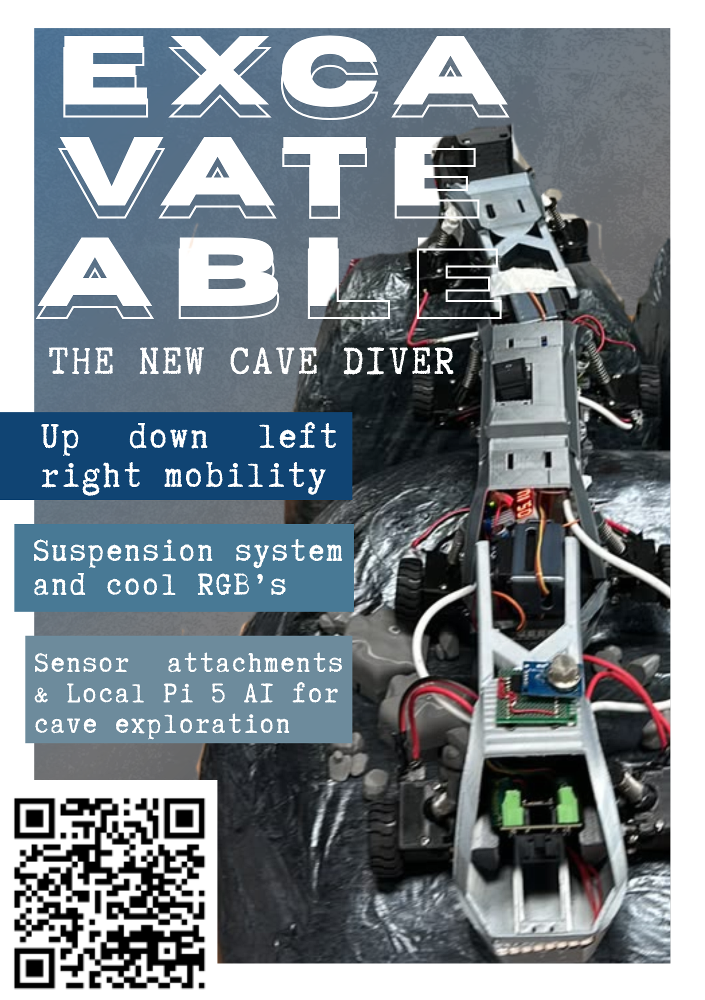

# ExcavatAble

## What is Excavatable? 
A robot designed for cave exploration, it manoeuvres left and right up and down using servos and motors, collects environmental data, and life feed of the environment. 

## Hardware 
3s 7200mah battery 
|----buck convert to 10.8v---pcb---drv8833: drive motor 
|----buck convert to 5v---pcb---esp32: to control movement of servo, sensors and servos 
|----buck convert to 6v---servo driver PCA9685: to power servo 

## PCB layout 
power terminal block input(5v)positive---capacitor25v 4200uf---esp32c3supermini 
power terminal block input(5v)negative 
| 
power terminal block output(5v)positive 
power terminal block output(5v)negative 

power terminal block input(10.8v)positive ----capacitor25v 4200uf---drv8833 motor driver---terminal block motor(left) 
power terminal block input(10.8v)negative                                             |---terminal block motor(right) 
| 
power terminal block output(10.8v)positive 
power terminal block output(10.8v)negative 

## CAD 
Segment(1)---Main Segment(2)---Segment---Head Segment(3) 
(1)segment: pcb, two motors, 2suspension, two servos(vertical + horizontal movement) 
(2)Main segment: 2pcb, four motors, two servos(vertical + horizontal movement),4suspensions 
(3)Head segment: pcb, two motors, 2suspensions,rasberry pi 5 16gb 
 
sensor attachment: ENS160+AHT21 and dht11 sensor, modular design swap out at any time, extra pin coming out of the pcb. 

## Software 
IT takes photos from a Raspberry Pi, processes them into a 3D mesh via a FastAPI backend, and renders them in a React + WebGL web viewer 
Quickstart: Run It Locally 
### 1. Start the Backend 
Head into the backend folder, set up your Python environment, and start the server. It will automatically fall back to local file storage and an in-memory job store (so no Docker, Redis, or MinIO required).

Bash
cd backend 
python -m venv .venv 
 Windows: .venv\Scripts\activate | Mac/Linux: source .venv/bin/activate  
pip install -r requirements.txt 
uvicorn app.main:app --host 0.0.0.0 --port 8000 --reload  
You’ll know it's working when you see the fallback warnings in the logs. Verify it at http://localhost:8000/api/v1/health.  

### 2. Start the Frontend 
Open a new terminal window for the frontend: 

Bash 
cd frontend 
npm install 
npm run dev 
Open http://localhost:5173 in your browser. You should see a green "Backend Connected" status. 

### 3. Run a Full Mock Scan (End-to-End) 
From the repo root directory (SnakeBot/), run the edge node simulation command: 

Bash 
python -m edge_node capture-and-upload --shots 20 --interval 0.1 --wait 
This generates synthetic photos, uploads them to your local backend, runs a mock 9-stage reconstruction pipeline, and outputs a job_id. Copy that job_id, paste it into the Job Lookup field on your frontend dashboard, and check out the rendered 3D mesh in the viewer. 

Using Real Hardware (Raspberry Pi 5 + Camera + Hailo-8L) 
If you want to use actual hardware: 

Find your computer's LAN IP (e.g., 192.168.1.50) so the Pi can reach your backend. 
 
Run the backend bound to all network interfaces: 

Bash 
uvicorn app.main:app --host 0.0.0.0 --port 8000 
Configure the Pi: SSH into your Raspberry Pi 5, navigate to edge_node/config/config.yaml, and update backend_url with your computer's LAN IP. 

Capture: Run your health checks and captures directly on the Pi: 

Bash 
python -m edge_node health-check 
python -m edge_node capture-and-upload --shots 20 --interval 1.5 --wait 
Default Ports & URLs 
Frontend UI: http://localhost:5173 (Demo map also available at /viewer/demo?format=demo) 

Backend API: http://localhost:8000 

API Docs: ` 
